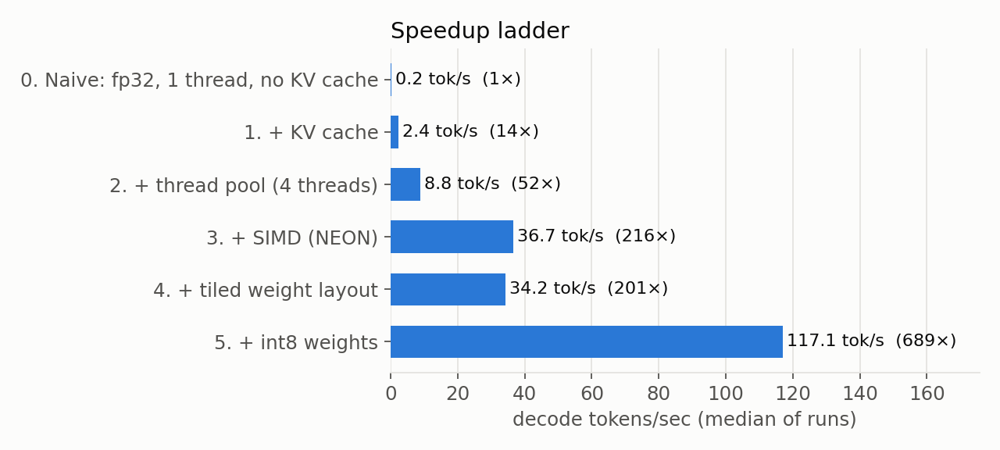
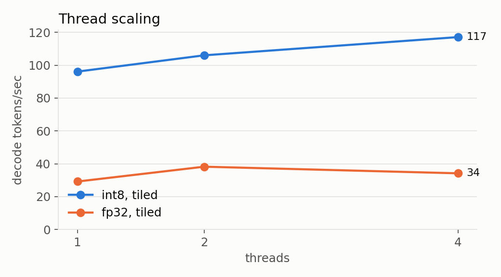
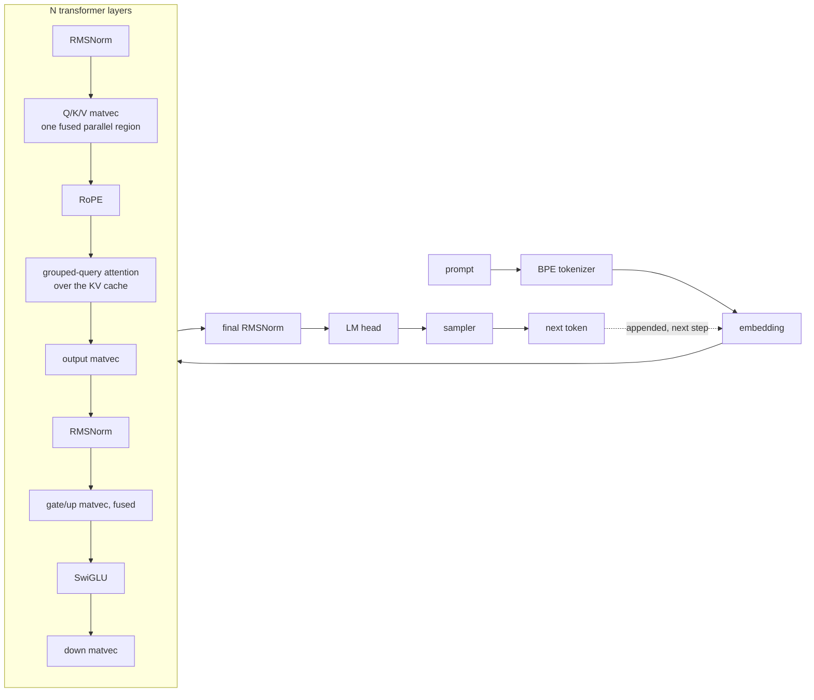

# llm-inference-engine

A dependency-free C++17 engine that runs Llama-family language models on the CPU: its own
safetensors converter, BPE tokenizer, transformer forward pass, NEON/AVX2 kernels, thread pool,
int8 quantization and an OpenAI-compatible server. No PyTorch, ggml or BLAS inside the engine.

<!-- demo GIF goes here: docs/demo.gif (see docs/GUIDE.md, "Recording the demo") -->

## Headline numbers

SmolLM2-360M, batch-1 decode on a MacBook Air (Apple Silicon), median of 5 runs:

| | Decode | Peak memory | WikiText-2 perplexity |
|---|---|---|---|
| Scalar baseline (fp32, 1 thread, KV cache) | 2.4 tok/s | 1,385 MB | 18.44 |
| **This engine (int8, NEON, 4 threads)** | **117 tok/s (49×)** | **393 MB (3.5× less)** | **18.57 (+0.66%)** |

Output matches Hugging Face `transformers` token-for-token: 20/20 prompts × 100 greedy tokens,
worst logit difference 2e-4 ([verification](bench/results/verification.md)).

| Step | Decode tok/s | Speedup vs step 0 | Peak memory |
|---|---|---|---|
| 0. Naive: fp32, 1 thread, scalar loops, no KV cache | 0.17 | 1× | 1,385 MB |
| 1. + KV cache | 2.4 | 14× | 1,385 MB |
| 2. + thread pool (4 threads) | 8.8 | 52× | 1,385 MB |
| 3. + NEON SIMD kernels | 36.7 | 216× | 1,385 MB |
| 4. + tiled weight layout | 34.2 | 201× | 1,385 MB |
| 5. + int8 weights (32-value blocks) | **117.1** | **689×** | **393 MB** |





How to read these honestly:

- **Step 0's gap depends on sequence length.** Without a KV cache every token recomputes the whole
  sequence, so the 14× from step 1 is for this 24-token run and grows with length. The fair
  "kernel + systems" speedup is step 1 → step 5: **49×**.
- **Step 4 looks like a regression at 4 threads, and isn't.** At 4 threads fp32 decode is capped
  by memory bandwidth (~50-55 GB/s here), so layout can't help, and the difference is within run
  noise. At 1 thread, where it can, tiling is +18% end to end (30.4 → 35.8 tok/s), and in the
  kernel microbenchmark it is the difference between 19 and 55 GB/s (see
  [What I learned](#what-i-learned)).
- **Where these were measured:** the real SmolLM2-360M weights, in a 4-vCPU Linux VM on the
  MacBook Air. Native macOS (8 cores) should do better; `bench/run_bench.py` reproduces the table
  on any machine (see [Benchmarking](#benchmarking)). Only decode is reported: prefill here
  includes paging the weights in from the host's shared folder.

Raw data: [`bench/results/macbook-air-vm-smollm2.json`](bench/results/macbook-air-vm-smollm2.json).

## Quick start

```bash
./scripts/setup.sh        # downloads SmolLM2-360M + WikiText-2, converts, builds (needs ~3 GB of disk)
./build/engine --model models/SmolLM2-360M/model-int8-tiled.bin \
               --tokenizer models/SmolLM2-360M/tokenizer.json \
               --threads 4 --temp 0.7 --top-p 0.9 --prompt "The capital of France is"
```

Requires a C++17 compiler and Python 3 (the converter and tests only). CMake is installed into
the project's virtualenv if it is missing.

Every run ends with a stats line (prefill tok/s, decode tok/s, peak memory, and the configuration):

```
[stats] prompt <n> tok | prefill <x> tok/s | decode <y> tok/s (<k> tok) | peak mem <m> MB | int8, blocked kernel (NEON+dotprod), 4 thread(s), kv-cache on
```

### CLI

| Flag | Meaning |
|---|---|
| `--threads N` | threads for matmuls and attention |
| `--kernel naive\|simd\|blocked` | matvec implementation (default `blocked`) |
| `--temp T`, `--top-k K`, `--top-p P`, `--seed S` | sampling; `--temp 0` is greedy |
| `--max-tokens N`, `--ignore-eos`, `--ctx N` | generation length and context size |
| `--no-kv-cache` | the step-0 baseline: recompute the whole sequence every token |
| `--perplexity FILE [--ppl-tokens N]` | score a text file instead of generating |
| `--no-mmap` | read weights into huge-page memory instead of `mmap` |

### OpenAI-compatible server

```bash
./build/server --model models/SmolLM2-360M/model-int8-tiled.bin \
               --tokenizer models/SmolLM2-360M/tokenizer.json --threads 4 --port 8080

curl -N localhost:8080/v1/completions \
  -d '{"prompt": "Once upon a time", "max_tokens": 64, "temperature": 0.8, "stream": true}'
```

`POST /v1/completions` supports `prompt`, `max_tokens`, `temperature`, `top_p`, `top_k`, `seed`,
`stop` and `stream` (Server-Sent Events, same wire format as OpenAI, so their client libraries
work). It holds back bytes that could be a partial UTF-8 character or the start of a stop
sequence, so streamed chunks are always valid text. `GET /v1/models` and `/health` are also there.

## How it works



| Module | What's in it |
|---|---|
| `scripts/convert.py` | safetensors (bf16/fp16/fp32) → flat binary; optional int8 blocks and 4-row tiled layout. Plain NumPy. |
| `src/model/` | `mmap` loader, forward pass, preallocated per-layer KV cache, fused parallel matvecs |
| `src/ops/kernels*.cpp` | matvec kernels: scalar, NEON (incl. SDOT int8), AVX2+FMA (incl. `maddubs` int8), row-blocked and tiled |
| `src/ops/thread_pool.*` | `std::thread` + condition variables, time-bounded spin before sleeping |
| `src/tokenizer/` | JSON parser, GPT-2 pre-tokenizer as a hand-written state machine with generated Unicode tables, BPE merges |
| `src/sampler.*` | greedy, temperature, top-k, top-p with a seeded RNG |
| `src/server/` | HTTP/1.1 + SSE on POSIX sockets |

**Why decode speed is about bytes, not FLOPs.** At batch size 1 each weight is used for one
multiply-add per token, so a token costs one full read of the weights: 1.45 GB in fp32. At ~55
GB/s that caps fp32 at ~38 tok/s, which is where steps 3-4 land. int8 blocks (1 byte per weight
+ one fp32 scale per 32) cut that to 0.41 GB, which is most of step 5's 3.2×.

## Correctness

| Check | Against | Result |
|---|---|---|
| Per-op unit tests (GoogleTest) | NumPy reference vectors | pass |
| Tokenizer, 1,256 strings (emoji, CJK, code, digits, specials) | HF `tokenizers` | 1256/1256 exact |
| Forward pass, every kernel × 1/3 threads × row-major/tiled, random GQA and QKV-bias models | independent NumPy implementation | max logit diff < 1e-4, greedy identical (118 checks) |
| int8 path | NumPy simulation of the same int8 arithmetic | max logit diff < 1e-5 |
| Real SmolLM2-360M tokenizer, same 1,256 strings | HF `tokenizers` | 1256/1256 exact |
| Real SmolLM2-360M, 20 prompts: final logits + 100 greedy tokens | HF `transformers` fp32 | 20/20 token-for-token, worst logit diff 2.0e-4 |
| WikiText-2 perplexity (8,176 tokens, 512-token windows) | fp32 vs int8 | 18.44 vs 18.57 (+0.66%) |

```bash
python3 tests/test_random_models.py build/engine     # no download needed (also runs in CI)
./scripts/verify.sh                                  # real model vs Hugging Face + perplexity
```

## Benchmarking

```bash
BENCH=1 ./scripts/setup.sh                                          # adds the fp32-tiled file
.venv/bin/pip install matplotlib
python3 bench/run_bench.py --model-dir models/SmolLM2-360M --machine my-mac
./build/bench_kernels 4                                             # kernel GB/s, hot vs cold
```

`run_bench.py` writes a Markdown table, JSON and both charts to `bench/results/`. It caches every
run, so an interrupted benchmark resumes where it stopped. To compare with llama.cpp on the same
model and quantization, convert with llama.cpp's `convert_hf_to_gguf.py --outtype q8_0` and pass
`--llama-bench path/to/llama-bench --gguf model-q8_0.gguf`.

## What I learned

- **Batch-1 decode is a memory-bandwidth problem.** One core with NEON already pulls ~42 GB/s (29 tok/s × 1.45 GB).
  Threads gave 3.7× on the compute-bound scalar kernel but only ~1.2× once SIMD made it memory
  bound. The big remaining win was moving fewer bytes (int8), not doing faster math.
- **A "faster" kernel can be slower out of cache.** Computing 4 rows at a time reuses each x
  load 4 times and won in cache (62 vs 56 GB/s), but streaming fp32 from DRAM it fell to 19 GB/s:
  4 rows 3.8 KB apart are 4 interleaved streams. Re-laying the weights so the 4 rows are
  interleaved in small tiles turns that into one sequential stream: 55 GB/s, the best of all.
  Measuring hot and cold separately (`bench_kernels`) is what exposed it.
- **Spin counts don't port.** The thread pool first spun 20,000 iterations before sleeping. On
  Apple Silicon that's a few microseconds, shorter than the serial work between parallel
  regions, so workers slept between every matmul and 4 threads were slower than 1. Spinning for
  a fixed *time* (500 µs) fixed it: int8 went from 87 to 125 tok/s at 4 threads (random-weight
  run; same shapes, same speed).
- **Testing int8 exactly needs care with ties.** Comparing against a NumPy int8 simulation
  failed by up to 1.0 logit on bf16 test weights. Cause: bf16 weights × int8-dequantized
  embeddings land exactly on .5 rounding boundaries, and two implementations break those ties
  differently by 1 ulp. With fp32 test weights the engine matches to ~3e-6.
- **Fewer, bigger parallel regions.** Q/K/V (and gate/up) read the same input, so they run as one
  parallel region over their concatenated rows, and int8 quantizes the shared input once.
